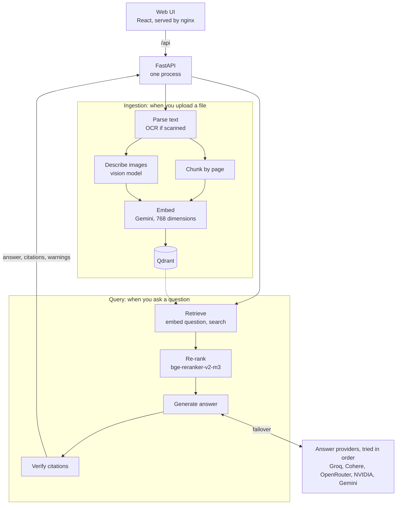

<div align="center">


# DocSense

Ask questions about your documents. Every answer comes with the page it was found on.


</div>

## Overview

DocSense is a question answering tool for documents. You upload a file, ask a question in plain language, and get an answer with the page number it came from. It also reads charts and diagrams inside the file. It has three modes: general questions about one document, comparison across several documents, and exact-clause retrieval for legal text.

This is Version 1. The backend and the API read PDF, DOCX and TXT files. The web page currently accepts PDF only; DOCX and TXT upload in the web page is planned. Later versions are listed in the [roadmap](#roadmap).

## Quick start with Docker

Follow these steps in order. You need an internet connection and several GB of free disk space.

1. **Install Docker Desktop.** Download it from the Docker Desktop page on docker.com and install it. On Windows, if Docker asks for WSL 2, open PowerShell as administrator, run `wsl --install --no-distribution`, and restart the PC. Then open Docker Desktop and wait until it says it is running.
2. **Download the project.** Either run `git clone https://github.com/Anishsingh14/DocSense.git`, or click the green **Code** button on the GitHub page, choose **Download ZIP**, and unzip the file.
3. **Open a terminal in the project folder.** It is the folder that contains `docker-compose.yml`.
4. **Create your keys file.** Copy `.env.example` to a new file named `.env`, open it, and paste your own free keys after the `=` signs:
   - `GEMINI_API_KEY` is required. It is used for embeddings and for reading images. Get it from Google AI Studio.
   - `RAG_Groq` is an answer provider. You need at least one answer-provider key. Groq is the first provider tried. Get its key from the Groq console.
   - The other lines are optional. Leave unused lines empty.
   - Never share your `.env` file.
5. **Start the app.** Run `docker compose up --build`. The first build takes several minutes and downloads a few GB. It is finished when the log shows the backend as healthy and the frontend as started.
6. **Open the site.** Go to this address in a browser:

   **http://localhost:8080**

   This is the only address to use. The terminal does not print a link, and the API is not published on a separate port.
7. **Ask a question.** Upload a PDF, choose a mode, and type your question.
   - **General Q&A:** questions about one document.
   - **Multi-Doc:** compare several documents in one question.
   - **Legal Precision:** returns the exact clause text instead of a paraphrase.
8. **Expect a slow first question.** The first question downloads the 2.3 GB re-ranker model once into a Docker volume. Later questions do not repeat the download and are faster.
9. **Stop and start again.** Press Ctrl+C in the terminal to stop. To start again later, run `docker compose up` (without `--build`). Your documents and the downloaded model are kept. **Do not run `docker compose down -v`**: it deletes them.

**If something goes wrong**

- **Docker is not running.** Open Docker Desktop and wait until it says it is running, then try again.
- **A key is missing or empty.** Check `.env`. `GEMINI_API_KEY` and at least one answer-provider key must have a value.
- **Port 8080 is already in use.** In `docker-compose.yml`, change the left number in `"8080:80"` (for example to `"9090:80"`), then open `http://localhost:9090`.
- **Not enough memory.** Give Docker Desktop about 6 GB or more if you can. This is a recommendation, not a guarantee.
- **The page does not load at first.** The site starts only after the backend reports healthy. Wait a minute and refresh.

Tested on Windows with Docker Desktop (WSL 2): an upload, a question with a cited answer, and a restart that kept the document and the downloaded model. It has not been tested on macOS or Linux.

## Features

- **Checked page citations.** The model cites passages by number. The code looks up each cited passage's stored page and drops any citation that does not match a retrieved passage.
- **Three modes.** General Q&A for one document, multi-document comparison, and exact-clause retrieval for legal text.
- **Two answer styles.** Summary, or Exact quotes. Legal Precision always uses Exact quotes.
- **Charts and diagrams.** A vision model describes embedded images, so questions about a chart can be answered and cited.
- **Scanned pages.** Pages with almost no text go through OCR.
- **Re-ranking.** A cross-encoder model reorders the retrieved passages before the answer is written.
- **Provider failover.** Answers are written by one of five LLM providers. If one fails or is rate limited, the next one takes over.
- **Warnings.** An answer is flagged when the passages scored low, when no citation could be verified, or when the answer was cut off at the output limit.
- **Provider shown per answer.** Each answer says which provider and model wrote it.
- **Evaluation framework.** A script measures retrieval and answer quality. An LLM judge, always a different provider from the writer, grades the answers.

## Architecture



| Component | Technology | What it does | Where |
|---|---|---|---|
| Web UI |    | Upload page, chat, cited sources, PDF preview | `DocSense-UI/src/` |
| Web server |  | Serves the built UI and forwards `/api` to the backend | `DocSense-UI/nginx.conf` |
| API |   | Upload, list, delete and query endpoints | `api/` |
| Parsing and OCR |  | Reads PDF, DOCX and TXT; OCR for scanned pages | `ingestion/` |
| Chunking |  | Splits text into page-aware chunks; legal files by clause | `chunking/` |
| Embeddings and vision |  | Turns chunks and questions into vectors; describes images | `embedding/`, `ingestion/image_analyzer.py` |
| Vector store |  | Stores chunks with document and page metadata | `embedding/vector_store.py` |
| Re-ranker |   | Scores each passage against the question | `retrieval/` |
| Answer providers |      | Write and grade answers, with failover | `generation/` |
| Evaluation |  | Retrieval check and LLM-judged answer quality | `evaluation/` |
| Packaging |  | Runs the backend and the web server together | `Dockerfile`, `docker-compose.yml` |

<details>
<summary>Ingestion pipeline: what happens when you upload a file</summary>

1. **Read.** Text is read page by page: PyMuPDF for PDF, python-docx for DOCX, plain reading for TXT. A page with almost no text goes through Tesseract OCR.
2. **Find images.** Embedded images smaller than 100 pixels are dropped. The rest go to a Gemini vision model, which writes a factual description and labels the image as a chart, diagram, table or photo. Decorative images are discarded.
3. **Chunk.** Text is split by paragraph into chunks of about 1,000 characters with a 150-character overlap. A chunk never crosses a page, and every chunk records its document and page number. Legal documents are split by clause instead.
4. **Embed.** Chunks and image descriptions are embedded with `gemini-embedding-001` at 768 dimensions.
5. **Store.** The vectors go into Qdrant with their metadata. The store runs in embedded mode, so no separate database is needed.

</details>

<details>
<summary>Query pipeline: what happens when you ask a question</summary>

1. **Retrieve.** The question is embedded with the same model and searched against the chosen documents.
   - Single document: the best passages are kept after re-ranking, up to 5.
   - Compare mode: each document gets its own candidates, so no requested document is left out. Each document keeps at least one passage, and two when there are up to 4 documents, within a cap of 8 passages.
   - Legal mode: searches legal documents only and adds each document's opening passage.
2. **Re-rank.** `bge-reranker-v2-m3`, a cross-encoder, reads the question and each passage together and scores them.
3. **Generate.** The passages go to an LLM labelled Source 1, Source 2 and so on. The model must cite them as "(Source N)". The first provider that works writes the answer. Failed providers go on a cooldown.
4. **Verify.** The code maps each cited number to the stored page, drops citations that point to nothing, and adds a warning when confidence is low or the answer was cut off.

</details>

The design decisions and the reasons behind them are in [TDR.md](TDR.md).

## Evaluation

These are measured results from the final run on 2026-11-03 (commit `3b9c014`, results file `eval_results_20261103T180353Z.json`, which is not stored in the repository).

| Measure | Result |
|---|---|
| Retrieval: the correct page was retrieved | 23 of 23 questions |
| Multi-document coverage: every requested document represented | 12 of 12 queries (32 of 32 documents) |
| Answers judged correct by an independent LLM judge | 18 of 23 (4 partial, 1 incorrect) |
| Answers correct on manual review | 20 of 23 |

Earlier improvements: retrieval went from 21/23 to 23/23, and multi-document coverage from 5/12 to 12/12.

The test set is small: 23 questions and 12 coverage queries over 6 sample documents, three of them real contracts from the CUAD dataset. Treat the numbers as a sanity check, not a benchmark. The runs used the Exact quotes answer style.

## Roadmap

| Version | Scope | Status |
|---|---|---|
| V1 | PDF, DOCX and TXT, three modes, page citations, image analysis | Current |
| V1 fix | DOCX and TXT upload in the web page (the backend already reads them) | Planned |
| V2 | PPTX and XLSX/CSV | Planned |
| V3 | Password-protected PDFs, old `.DOC`, handwriting OCR | Planned |
| V4 | Multi-user accounts, persistent history, confidence scoring in the UI | Planned |
| Later | Bring your own API key, hosted deployment | Planned |

## Known limitations

- Single user, no login. Do not expose it to the public internet.
- The web page accepts PDF only for now. DOCX and TXT upload in the web page is a planned fix.
- Answers can take tens of seconds on a CPU. Most of the time goes to the re-ranker and to slow free-tier providers.
- Free LLM tiers have rate limits.
- The answer model sometimes wrongly says "not found", or quotes only part of a clause.
- Legal mode was tested on one document at a time.
- Summary answers have not been evaluated. The measured results used Exact quotes.
- No handwriting OCR. English only. The upload limit is 25 MB.
- Documents are sent to third-party AI providers (Gemini and the answer providers). Do not upload confidential files.

## Run without Docker (Windows)

1. Install Python 3.13 and Node.js (the Docker image uses Node.js 20).
2. For scanned PDFs, install Tesseract and Poppler and add them to your PATH.
3. In the project folder, run `pip install -r requirements.txt`.
4. In the `DocSense-UI` folder, run `npm install`.
5. Copy `.env.example` to `.env` and add your keys, as in the quick start.
6. Double-click `start.bat`. It opens the API and the UI in two windows, then opens `http://localhost:5173`.

Never run `start.bat` twice. The local Qdrant store allows only one backend process.

## Configuration

Set these in `.env`. The file is never committed.

| Variable | Purpose |
|---|---|
| `GEMINI_API_KEY`, `GEMINI_API_KEY_2` to `GEMINI_API_KEY_7` | Embeddings and image reading. One is enough. Extra keys from other Google projects add quota. |
| `RAG_Groq`, `RAG_Cohere`, `RAG_OpenRouter`, `RAG_NVIDIA`, `RAG_Gemini` | Answer providers, tried in this order. At least one is required. |
| `RAG_SiliconFlow`, `RAG_OpenCode_Console` | Listed in the file but disabled in the code. |
| `GEMINI_VISION_MODEL` | Optional. Overrides the image-reading model. |
| `DOCSENSE_EMBEDDING_BACKEND` | Optional. Set to `local` to use a local embedding model. |
| `QDRANT_URL`, `QDRANT_API_KEY` | Optional. Use a hosted Qdrant instead of the embedded store. |
| `ANTHROPIC_API_KEY`, `VOYAGE_API_KEY` | Not used at present. |

## API

The backend is a FastAPI app. Under Docker it is reachable only through the site, at `/api`. Without Docker it runs on port 8000, and its interactive docs are at `http://127.0.0.1:8000/docs`.

| Method | Path | Purpose |
|---|---|---|
| GET | `/health` | Status and configuration. No provider call. |
| POST | `/documents` | Upload a PDF, DOCX or TXT file (up to 25 MB). Returns 202 and a `job_id`. |
| GET | `/documents/jobs/{job_id}` | Ingestion status: `queued`, `running`, `done` or `failed`. |
| GET | `/documents` | List stored documents. |
| DELETE | `/documents/{doc_id}` | Delete a document's chunks. |
| POST | `/query` | Ask a question in `single_doc`, `multi_doc` or `legal` mode. |

Errors: 415 unsupported type, 413 too large, 404 unknown id, 422 invalid input or unreadable file, 503 providers or embeddings unavailable.

Request:

```json
{ "question": "What is the termination notice period?",
  "mode": "single_doc",
  "doc_ids": ["SampleServices_MSA_Contract"],
  "answer_style": "full" }
```

Response (the list of retrieved passages is shortened to one):

```json
{
  "question": "What is the termination notice period?",
  "mode": "single_doc",
  "core": {
    "answer": "\"Either party may terminate this Agreement with thirty (30) days written notice to the other party.\" (Source 1)",
    "citations": [
      { "source_number": 1, "doc_name": "SampleServices_MSA_Contract.pdf", "page_num": 3 }
    ]
  },
  "evidence": {
    "sources": [
      { "source_number": 1, "doc_name": "SampleServices_MSA_Contract.pdf", "page_num": 3,
        "section": "4.2 Termination for Convenience",
        "text": "4.2 Termination for Convenience. Either party may terminate this Agreement with thirty (30) days\nwritten notice to the other party." }
    ]
  },
  "meta": {
    "provider_used": "RAG_Groq",
    "model_used": "openai/gpt-oss-20b",
    "citation_check": { "valid_citations": 1, "discarded_citations": 0, "warning": null }
  }
}
```

## Project structure

```
api/             FastAPI app: routes, schemas, error mapping, offline tests
chunking/        Page-aware and clause-aware chunking, document type guess
data/            Sample documents, the labelled question set, dataset notes
docs/assets/     README images
DocSense-UI/     React web UI, nginx config and its Dockerfile
embedding/       Gemini embeddings and the Qdrant store
evaluation/      Evaluation script, LLM judge, question sets
generation/      Prompts, provider failover, citation checks
ingestion/       PDF, DOCX and TXT parsing, OCR, image extraction and analysis
retrieval/       Search, candidate selection and re-ranking
Dockerfile       Backend image
docker-compose.yml   Backend and web server
start.bat        Local start on Windows without Docker
```

## Documentation, licence and notices

- [PRD.md](PRD.md): what the product does and what is in scope for each version.
- [TDR.md](TDR.md): technical design, decisions and test results.
- Licence: MIT, see [LICENSE](LICENSE).
- Dataset credit: three sample contracts come from the Contract Understanding Atticus Dataset (CUAD), by The Atticus Project, under CC BY 4.0. See [data/README_datasets.md](data/README_datasets.md).

Product and company names and logos are trademarks of their respective owners. DocSense is not affiliated with or endorsed by them.
